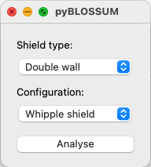

# pyBLOSSUM - a tool for assessing the Ballistic Limit Of Spacecraft Structures Under Micrometeoroid and orbital debris impact

This repository provides ballistic limit equations (BLEs) for calculating the performance of spacecraft structures under impact by micrometeoroid and orbital debris (MMOD) particles at hypervelocity.

## Getting started
To download this Git project open a terminal/command prompt and enter:
```
git clone https://github.com/shannonjryan/pyBLOSSUM.git
```
If you already have a previous version of the project you can simply update by navigating to the location of the repository and running:
```
git pull
```
## Setup
Requirements:
- Anaconda (https://www.anaconda.com/download)
- Python 3.12
	
The pre-requisite python packages are included in the 'environment.yml' file. To create an Anaconda environment based on the yml file open a terminal session and browse to the directory in which you cloned this repository. Run the following command:
```
conda env create --file environment.yml
```

## Comparing experimental data and BLE predictions
Experimental datasets are provided in the 'data' directory for the following shielding configurations:
* Whipple shields
* Stuffed Whipple shields
* Honeycomb core sandwich panels
* Foam core sandwich panels

Test results from those datasets can be plotted together with the ballistic limit curves. For example, if you define a Whipple shield configuration that is nominally identical (or very similar) to one in the experimental dataset, then the corresponding experiments can be included in your generated ballistic limit curve. 

## Contributing experimental data
New hypervelocity impact test results and corrections to existing records are welcome.

- **Suggest new data.** Open a GitHub issue with the paper, report, or dataset citation, the shielding configuration, and the table or page containing the results. A DOI, URL, or report number helps us locate the source.
- **Report a correction.** Include the CSV filename, the source and shot ID, the current and proposed values, and the source that supports the change.
- **Submit a pull request.** Update the relevant CSV in `data/`, following its existing column names and units. If you’re adding a new source, include it in `data/data_sources.bib` and use its citation key in the CSV. Reference the relevant table or page in the pull request description.

## Running pyBLOSSUM
pyBLOSSUM can be run either as a GUI or from the command line/terminal. Depending on how you intend to run the code, the process will vary.

### Running via the GUI
Activate the python enviroment by running:
```
conda activate pyBLOSSUM
```

To launch the GUI navigate to the pyBLOSSUM installation directory and run:
```
python pyBLOSSUM.py
```
This will launch the GUI, as seen below.



### Running via command line
Activate the python enviroment by running:
```
conda activate pyBLOSSUM
```
A specific BLE can be called directly from the command line. Navigate to the pyBLOSSUM installation directory and run:
```
python BLEs\<BLE_filename> <input_filename> 
```
where <BLE_filename> should be replaced by the name of the BLE python file you want to call and <input_filename> should be replaced by the name of a csv file that defines your target configuration. 

<em>NOTE: for mac and unix-based systems replace "\\" with "/" in all path definitions.</em>

For example,
```
python BLEs\BLE_foamSP.py input_files\eval_example-foamSP.csv
```
This evaluates the foam sandwich panel defined in `eval_example-foamSP.csv`.
Use the matching example in `input_files/` as a template for each target
configuration. Keep the column headers on the first row and the units on the
second row, then enter the configuration values on the third row. The scripts
use the units shown in the examples when interpreting the input values.

If a BLE command fails, it prints an error to standard error and exits with a
nonzero status.

To include experimental data in the generated plots, include the flag --data, e.g.,
```
python BLEs\BLE_foamSP.py input_files\eval_example-foamSP.csv --data
```

## Output
Each command-line analysis saves its outputs together in a new folder under
`results/`, named `run_YYYYMMDD_HHMMSS_ffffff`. The command prints the folder path.
The GUI displays the plot and lets you choose which files to save. **Save plot**
writes the PNG, and **Save data** writes the curve and configuration CSVs. If
you select either option, the GUI creates one run folder for the saved files.

- `plot_<date_time>.png` contains the ballistic limit plot.
- `blc_data_<date_time>.csv` contains the velocity and critical projectile diameter values used in the plot.
- `config_data_<date_time>.csv` contains the configuration with the units on the second row. Values are written in the input units, such as MPa for wall yield strength.
- `test_data_<date_time>.csv` contains the experimental points when a supported analysis includes experimental data and saves the CSVs.

Files from the same run share a timestamp.


## Tests and validation curves

Run the targeted tests after a code change:

```console
python -B -m unittest discover -s validation/tests -v
```

Evaluate the JSON configurations against Git-commit pyBLOSSUM reference curves
and independent XLSX reference curves:

```console
python -B validation/validate_curves.py
```

Open the printed `index.html` report for pass/fail results, curve overlays,
relative-error plots, and per-point CSV data. Every run creates a new directory
under `validation/reports/`, which is excluded from Git. The runner reads the
reference workbooks without changing them or recalculating their stored values.
Commit snapshots are captured automatically and reused. Uncommitted model or
configuration edits compare against HEAD; committed code compares against
HEAD's first parent. No separate baseline-update command is needed.

To explicitly use committed workbooks (for example when a OneDrive file is
unavailable locally), run:

```console
python -B validation/validate_curves.py --git-ref HEAD
```

This still uses the current Python code, JSON configurations, automatic commit
baselines, and tolerance definitions.
A failed comparison or unreadable reference returns a nonzero exit code.
See [validation/README.md](validation/README.md) for coverage, tolerances, report
details, and how to investigate failures.

## License and Acknowledgements
This project is licensed under the MIT License - see [LICENSE.md](LICENSE.md) for details.

If you use this repo or the data included in the repo for research, please cite the following paper:
S. Ryan, "pyBLOSSUM: An open-source python repository for assessing the ballistic limit of spacecraft structures under space debris impact", International Journal of Impact Engineering; 203: 105365, 2025


